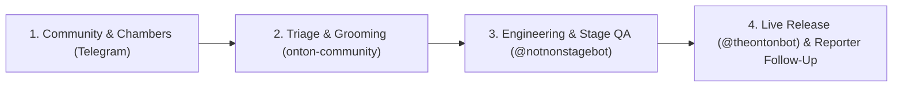

# ONTON Community Hub

Public feedback tracker, UX improvement board, Organizer workflow requests, and DAO Chamber proposals for **ONTON (`v2.1`)**.

---

## How Community Feedback Works

Every bug report, organizer request, UX improvement, and governance proposal raised across our official Telegram Chambers is tracked here in plain language from initial report to live release.

### Issue Lifecycle Labels

| Label | Meaning |
| :--- | :--- |
| `status:triage` | Newly captured from a Telegram Chamber — awaiting review and deduplication |
| `status:groomed` | Scoped, prioritized, and queued for engineering execution |
| `status:in-progress` | Active engineering implementation underway |
| `status:stage-testing` | Deployed on **Staging (`@notnonstagebot`)** — ready for reporter & Review Council verification |
| `status:shipped` | Verified and live on **Production (`@theontonbot`)** |
| `status:needs-followup` | Waiting for reporter confirmation or additional details |

### Priority Levels

| Label | Scope |
| :--- | :--- |
| `priority:critical` | Live event blocker, ticket payment issue (TON / USDT / Stars), check-in QR failure, or security report |
| `priority:high` | Reproducible bug, Review Council consensus item, or active Event Host blocker |
| `priority:medium` | UX improvement, organizer workflow upgrade, or Chamber proposal (OIP) |
| `priority:low` | Copy refinement, visual polish, or minor enhancement |

---

## Official Telegram Chambers & Community Hubs

| Chamber / Hub | Focus | Issue Label |
| :--- | :--- | :--- |
| **ONTON Senate Review Council** | Pre-release sanity checks, tokenomics review & live QA | `chamber:review-council` |
| **Chamber 3 — ONTON Senate** | Genesis ONION NFT holders & `$ONIT` Governors (6 structured Forum topics) | `chamber:senate` |
| **Chamber 2 — Organizer Council** | Verified Event Hosts, Pro Organizers & Founding Hosts | `chamber:organizer-council` |
| **Chamber 1 — Citizen Assembly** | Public Community (`@ontonsupport` EN & `@ONTONChatRU` RU) | `chamber:citizen-assembly` |

See [`CHAMBERS_AND_CONTRIBUTORS.md`](./CHAMBERS_AND_CONTRIBUTORS.md) for the directory of Chambers and recognized community contributors.
